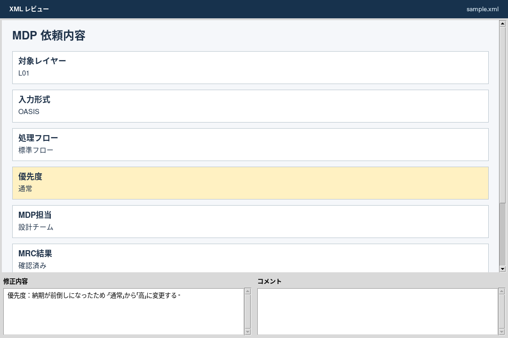

# XML レビュー



固定ヘッダーにはアプリ名と開いているXMLのファイル名を表示する。その下の領域の上8割に、XMLをXSLで変換したHTMLを表示する。右端のスクロールバーで文書全体を閲覧できる。下部の2割は左右に等分し、左に修正内容、右に自由記入用のコメント欄を配置した。コメント欄の編集内容は終了時に破棄される。

## 起動

Tcl/Tk 8.6、同じTcl環境から読み込めるTkhtml 3、PATH上のxsltprocが必要。xml-viewerフォルダーで起動する。

```bash
wish viewer.tcl             # 同梱のsample.xmlを表示
wish viewer.tcl report.xml  # 自分のXMLを表示
```

## 修正箇所の指定

対象のboxにmark="review"を付け、reasonに修正内容を書く。上段には現在の値が表示され、左下には項目名と修正内容がXML順に並ぶ。指定のないマスは白色になる。

```xml
<box title="優先度" mark="review"
     reason="納期が前倒しになったため、「通常」から「高」に変更する。">通常</box>
```
