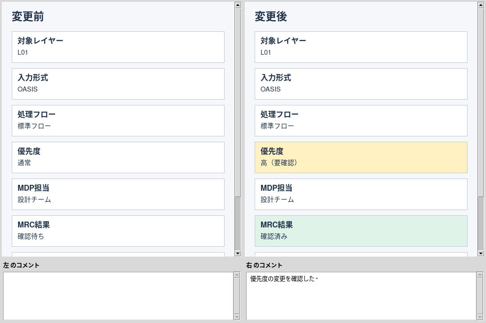

# XML レビュー

Tcl/Tk 8.6、同じ Tcl 環境から読み込める Tkhtml 3、PATH 上の xsltproc が必要。
展開したフォルダーで次を実行する。

    wish viewer.tcl

自分の XML を左右に表示する場合は順番に指定する。

    wish viewer.tcl before.xml after.xml

XML の構造は left.xml と right.xml を参照。report の title がページ名、box の title が見出し、要素の本文が内容となる。
各 box に mark="review" を付けると黄色、mark="ok" で緑色になる。省略時は白色。配色は report.xsl の background 変数で変更する。
左右のスクロールバーで個別に閲覧できる。コメントは画面を閉じると消える。
