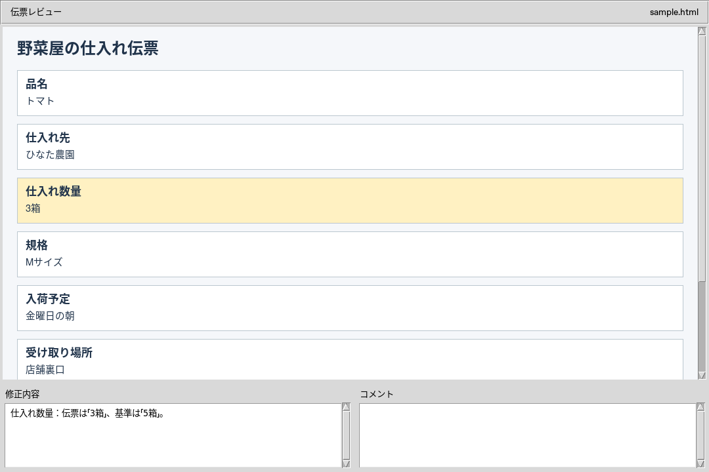

# 野菜屋の仕入れ伝票レビュー



## 生成済みのサンプルを開く

このフォルダーで次のコマンドを実行する。表示に必要なのは Tcl/Tk と、その環境用の Tkhtml 3。GUIはTcl/Tk 8.4を互換目標とし、8.6で動作確認した。

```sh
wish viewer.tcl                 # 同梱の sample.html を表示
wish viewer.tcl order.html      # 指定したUTF-8のHTMLを表示
```

ヘッダーの下は全幅の伝票で、下段だけを左右に分割する。左下に修正対象の項目名と理由を表示し、右下は空欄で開く。コメントの編集は終了時に破棄される。

## XMLからHTMLを生成する

入力例は `sample.xml`、表示ルールは `report.xsl`、生成結果は `sample.html`。XMLやXSLを編集したら、Pythonで再生成してからGUIで開き直す。

```sh
python3 -m pip install lxml
python3 generate_html.py
wish viewer.tcl
```

ファイルを指定する場合は次のように実行する。

```sh
python3 generate_html.py order.xml --xsl report.xsl -o order.html
wish viewer.tcl order.html
```

## Pythonによる自動チェック

入力XMLには伝票に記載された値を書く。

```xml
<box title="仕入れ数量">3箱</box>
```

`generate_html.py` 冒頭の `EXPECTED_VALUES` に、このサンプルの基準として「仕入れ数量は5箱」と定義した。Pythonは項目名で基準を引き、前後の空白を除いた値を文字列として比較する。

| XMLの仕入れ数量 | 生成されるHTML | GUIの左下 |
|---|---|---|
| 3箱 | 3箱のマスが黄色 | 仕入れ数量：伝票は「3箱」、基準は「5箱」。 |
| 5箱 | 5箱のマスが白 | 指摘なし |
| 項目自体がない | 末尾に黄色の「未記載」マスを追加 | 仕入れ数量：項目が未記載。基準は「5箱」。 |

基準に含めた項目をチェックする。色と指摘はHTMLを生成するたびに再計算し、入力XMLは書き換えない。`sample.xml` の「3箱」を「5箱」に変えて再生成すると、仕入れ数量の指摘が消える。
